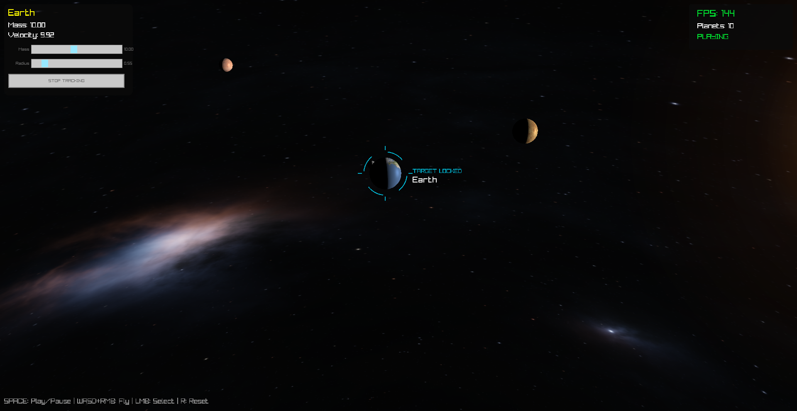

# Stardust

A real-time 3D N-body gravity simulation in C++20 with [raylib](https://www.raylib.com/).
The Sun, the eight planets and the Moon all pull on each other every physics step;
nothing moves on rails. Orbits come out of Newton's law of gravitation and the
starting conditions, and you can break them: click a planet and drag its mass or
radius slider while the simulation runs. Planets that collide merge.

raylib provides the window, input, model loading and drawing. The simulation,
integrator, collision handling, camera controls, HUD and the HDR sky loader are
this project's own code.



*Captured with `Stardust.exe --screenshots`, after 6 simulated seconds of the scripted run.*

## Highlights

- **Physics library with no graphics dependency.** `src/sim/` builds and is
  tested on its own (CI runs its tests on Linux with GCC, with no raylib at all).
- **Velocity Verlet integration at a fixed 600 steps per second**, decoupled from
  the frame rate with an accumulator, so results are identical at 60 Hz and 144 Hz
  and a stalled frame cannot fling planets out of orbit.
- **Conservation checked by tests.** In a 300-second run of the full system the
  total energy stays within 1e-6 (relative) and momentum within 1e-9 of where it
  started. Merges conserve momentum and centre of mass.
- **Fast custom HDR loader** for the 93 MB nebula sky: about 0.3 s instead of
  3.4 s for the previous version, with byte-identical output (measured; see
  [docs/MEASUREMENTS.md](docs/MEASUREMENTS.md)).
- **52 unit tests** (GoogleTest), a benchmark tool, a scripted screenshot mode
  for checking rendering, and CI on Windows (MSVC) and Linux (GCC).

## Build and run (Windows)

You need **Visual Studio 2022 or newer** with the *Desktop development with C++*
workload (it includes CMake). The first configure downloads raylib 5.5 and
GoogleTest 1.17.0, so you need internet access once.

**In Visual Studio:** *File > Open > Folder...*, choose this folder, wait for
"CMake generation finished", pick **Release** in the configuration box, pick
**Stardust.exe** as the startup item and press F5.

**From a terminal** (use *Developer PowerShell for VS* so the compiler is found):

```
cmake --preset release
cmake --build --preset release
build\release\Stardust.exe
```

Run the tests with `ctest --preset release`, and the benchmark with
`build\release\stardust_bench.exe`.

The app finds `assets/` and `resources/` by itself, so you can start it from any
folder. If the sky shows as a magenta checkerboard, the sky file could not be
loaded and the console says why.

## Controls

| Input | Action |
|---|---|
| Space | Play / pause (starts paused) |
| Hold right mouse button | Look around |
| Right mouse + W A S D / Q E | Fly (speed adapts to distance from the nearest planet) |
| Right mouse + scroll | Change fly speed |
| Scroll | Move forward / back (or zoom while tracking) |
| Left click | Select a planet; click empty space to deselect |
| HUD sliders | Change the selected planet's mass and radius live |
| TRACK PLANET button | Camera follows the selected planet |
| R | Reset to the starting system |

`Stardust.exe --screenshots <folder>` runs a short scripted demo, saves three
pictures into the folder and quits.

## How it works

Each frame: read input, then advance the physics in as many fixed 1/600 s steps
as the elapsed time allows (at most 0.1 s worth per frame), then draw.

One physics step (`src/sim/Simulation.cpp`):

1. Compute every body's acceleration from every other body:
   `a = G·m·d / (|d|² + ε²)^1.5`. That is Newton's inverse-square law with a small
   softening length ε = 0.01 so the force never becomes infinite. Each pair is
   visited once and both bodies get equal and opposite pulls.
2. Velocity Verlet ("kick-drift-kick"): half a velocity update, a full position
   update, recompute forces, the other half velocity update.
3. Merge any bodies whose centres are closer than 0.8 × the sum of their radii. The
   heavier one survives (the Sun always survives); mass adds, volume adds, and the
   merged body keeps the pair's momentum and sits at their centre of mass.

Starting conditions (`src/sim/SolarSystem.cpp`): every planet starts at
circular-orbit speed `v = sqrt(G·M/r)` around its parent (G = 1, Sun mass 2000),
and the Sun gets the velocity that makes the total momentum zero, so the system
does not drift. The Moon starts 0.9 units from Earth, about 38% of Earth's Hill
radius. The masses are tuned for a compact, watchable system, not copied from the
real Solar System (Earth is 10, Jupiter 3).

Positions and velocities are `double`: measurements showed `float` rounding
swamped the integrator's own accuracy over long runs.

## Project layout

```
src/sim/       the physics (no raylib): vectors, gravity, integrator, collisions,
               fixed timestep, starting scenario, conservation diagnostics
src/io/        the HDR sky decoder (no raylib)
src/app/       the raylib application: main loop, input, camera, HUD, debris
tests/         GoogleTest unit tests
tools/bench/   stardust_bench, which reproduces every measured number
third_party/   raygui.h and rlights.h (single-header libraries by the raylib authors)
assets/        planet models (.glb) and the HDR sky
resources/     GLSL shaders
docs/          audit, measurements, decisions, roadmap, learning material
```

## Documentation

- [docs/FINAL_REPORT.md](docs/FINAL_REPORT.md): summary of the November 2026 overhaul
- [docs/learn/](docs/learn/README.md): learning path through every part of the
  project, with exercises and interview questions
- [docs/AUDIT.md](docs/AUDIT.md): problems found in the previous version and where
  each was fixed
- [docs/MEASUREMENTS.md](docs/MEASUREMENTS.md): every number, with how it was measured
- [docs/decisions/](docs/decisions/): why the main design choices were made
- [docs/ROADMAP.md](docs/ROADMAP.md): what to build next
- [docs/CHECK_BY_EYE.md](docs/CHECK_BY_EYE.md): manual test checklist
- [docs/GIT_GUIDE.md](docs/GIT_GUIDE.md): branches, tags and how to merge the overhaul
- [docs/RESUME_CLAIMS.md](docs/RESUME_CLAIMS.md): what this project supports claiming

## Known limitations

- Collisions are sphere-against-sphere and checked once per step, so two very fast
  small bodies could pass through each other in one step (not seen at these speeds).
- No shadows: planets do not eclipse each other. The shader has no ambient light,
  so the night side is black.
- Physics is not interpolated between steps for drawing; at 600 steps per second
  the leftover is at most 1/600 s, which is not visible.
- `pluto.glb` is in `assets/` but is not part of the scenario.
- Venus and Uranus spin backwards on purpose; so do the real ones.
- The clone is about 100 MB because the sky and models are in normal git history.
- The sources and licences of the `.glb` models and the HDR sky are not recorded yet.

## Other branches

`release/sd-winApp` is the Windows desktop line. `main` and `release/sd-androidApp`
hold an earlier mobile build (touch controls, a JNI bridge to a host Android app,
OpenGL ES shaders) that this README does not describe. `desktop` is an older copy
of the desktop line. Snapshots of every branch as of 2 November 2026 are kept as
tags named `archive/2026-11-02/<branch>`.

## License

Educational code; take what you want from it.
